# Book Tracker


An Android reading journal for books, reading sessions, notes and personal goals. Your library is stored locally; no account is required.

## Screenshots

<table>
<tr><th>Stats</th><th>Library</th></tr>
<tr><td>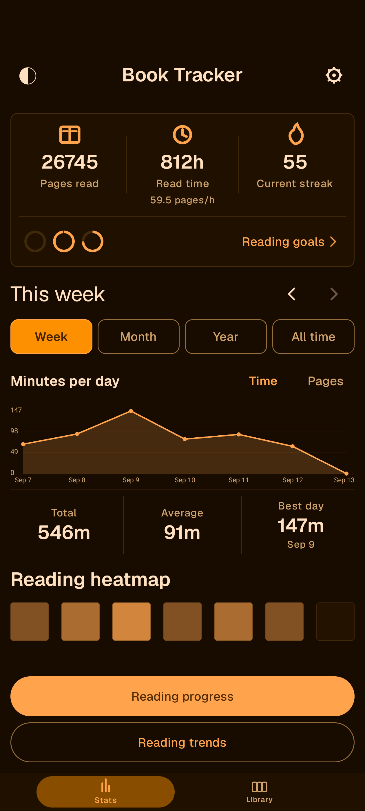</td><td>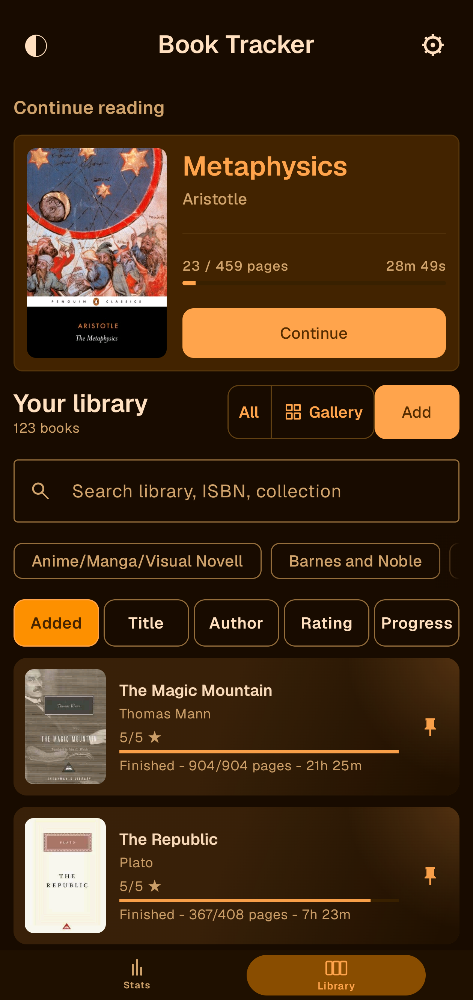</td></tr>
<tr><th>Book details</th><th>Edit book</th></tr>
<tr><td>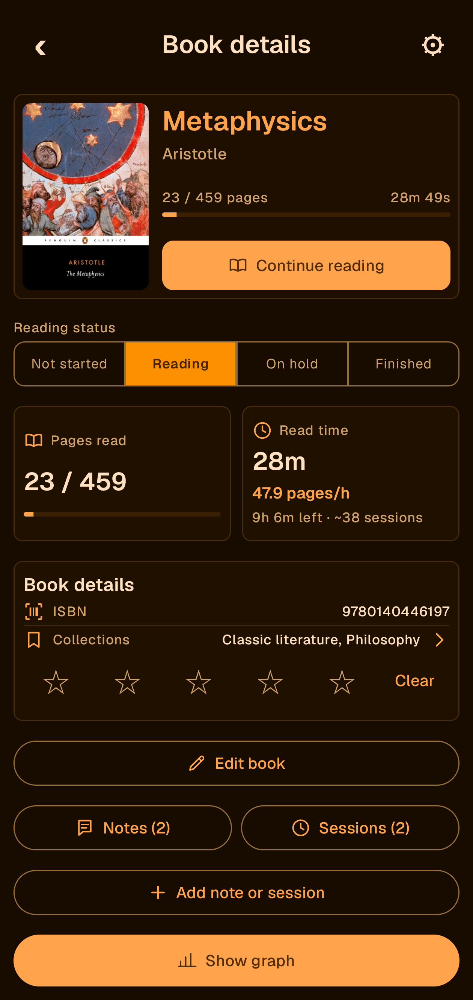</td><td>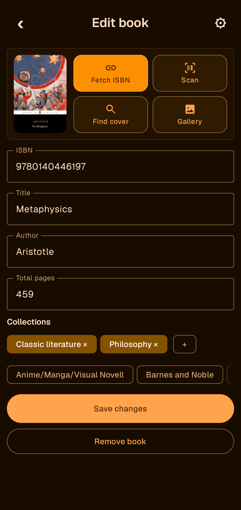</td></tr>
<tr><th>Reading goals</th><th>Reading progress</th></tr>
<tr><td>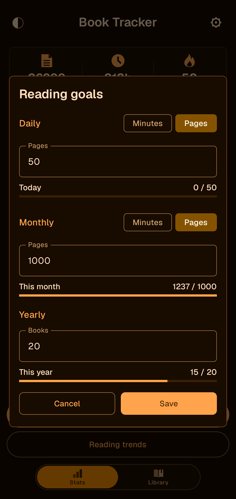</td><td>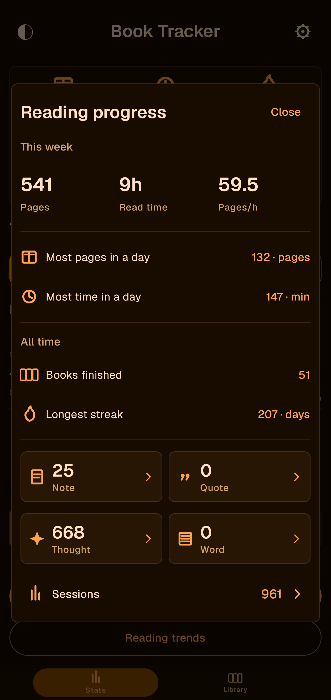</td></tr>
<tr><th>Author trends</th><th>Collection trends</th></tr>
<tr><td>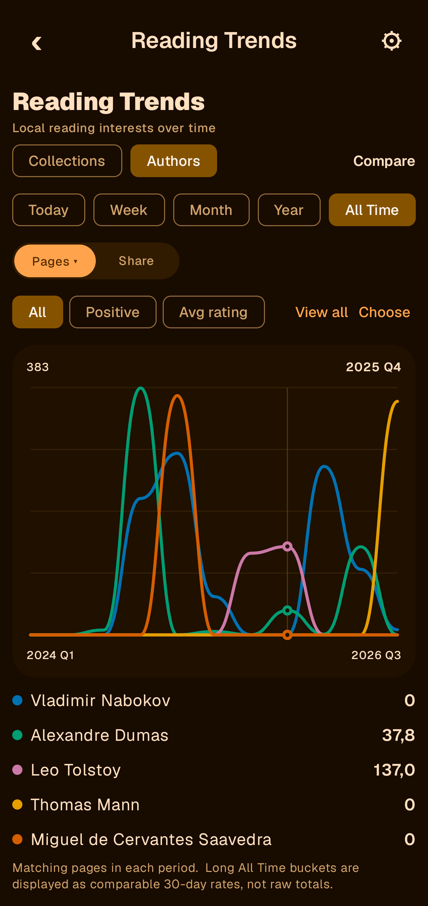</td><td>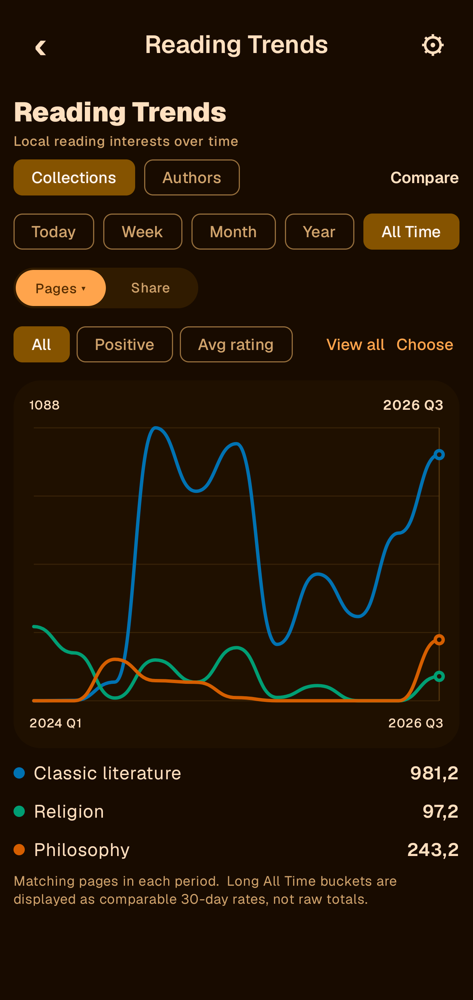</td></tr>
<tr><th>Contents scanning</th><th>Google Drive backup</th></tr>
<tr><td>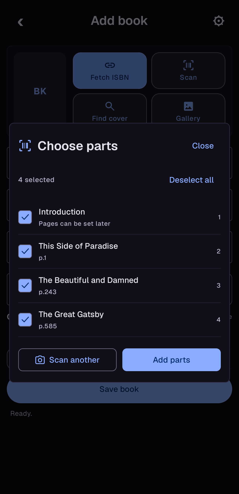</td><td>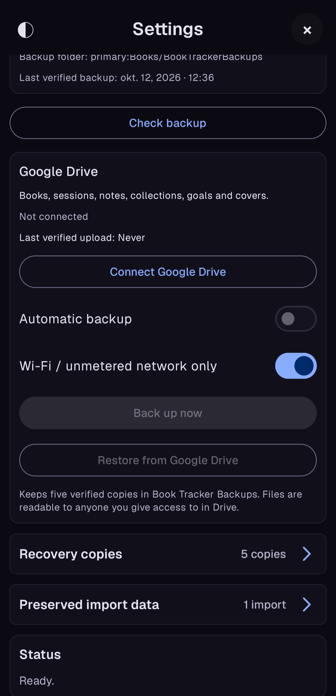</td></tr>
</table>

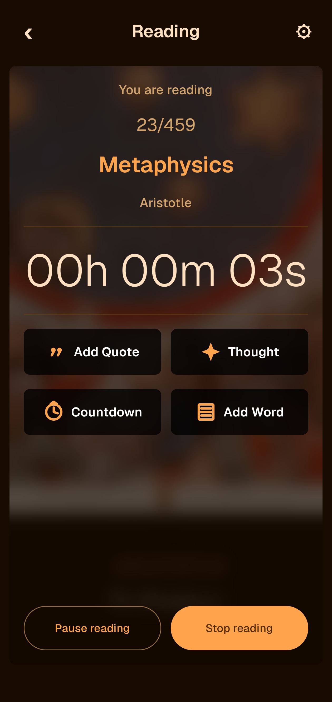

## Features

- Library list and gallery, pinned books, search and manual reading status. Gallery cards support adjustable columns, frosted cover previews and optional hidden titles.
- Typed collections for themes, book types, publishers and other groups. Expand collection chips, assign or remove them across selected books, undo assignments, rename and merge.
- Expand collections in Add book and Edit book to see all chips. Scroll while expanded, then collapse to return to the fixed layout.
- Reading map connects books and overlapping collections, with status colours and filters by collection type.
- Collection progress shows status breakdowns and actual pages read. Tap a collection for pace, remaining time, session estimates and books closest to completion.
- Sort by total pages, title, author, rating or progress; deselect sorting to use date-added order. New books start as Not started.
- Light, dark and adaptive themes, selectable accent colours and an optional Extra dark setting.
- Tap an author in Book details to search your entire library for that author.
- Reading timer with pause/resume, manual sessions and durations longer than 24 hours. Continue reading follows your latest session, independent of library filters.
- Swipe left to start reading; swipe right to pin or unpin.
- Automatically saved reading notes, global note search and copying notes in date order.
- Daily and monthly time/page goals, yearly book goals, heatmaps and reading progress summaries.
- An ongoing Reading goals notification shows daily, monthly and yearly progress. Settings has independent switches for overall reading-goal and individual book-goal notifications.
- Reading trends compares authors or collections over Today, Week, Month, Year or All time. Choose Pages, Time or Sessions, compare totals or share, and inspect positive ratings or average ratings.
- Interactive Stats and book graphs: hold and drag to inspect points. Stats keeps the same sizing across periods and fits the available screen area.
- Per-book deadlines or daily page targets, with today's remaining pages, estimated reading time and finish date. Swipe the Pages read card to set a goal. Active goals have a separate ongoing notification. Time estimates use book pace, then publisher pace, then overall pace.
- Compendium parts with inclusive page ranges, individual covers and ratings. Inspect each work through segmented progress bars and the reading screen. Reading time is split proportionally when a session crosses parts, and completed works appear separately in statistics until the compendium is finished.
- Scan contents pages with the camera or import photos to propose part titles and start pages. Recognition runs on the device; review, deselect and edit the proposals before applying them. Multiple photos can be combined.
- Historical sessions can count toward lifetime totals while being excluded from dated statistics.
- ISBN scanning and metadata from Open Library, Google Books and Libris, with missing fields filled across matching editions.
- Cover search by ISBN, title or author, optional Google Images search, and local cover selection.
- Page calculator for session logs in compendiums and editions with different page numbering.
- Verified JSON backups with embedded covers, collection types and book goals. Check a backup before restoring, export local recovery copies and inspect preserved original import data.
- Optional Google Drive backup, manual or automatic, with Wi-Fi-only scheduling and five verified versions. Download a version into the import preview before restoring to an empty library. See [Drive setup](docs/GOOGLE_DRIVE_BACKUP_SETUP.md).

## Install and update

Download the signed APK from [GitHub Releases](https://github.com/Roinur/Book-Tracker/releases/latest). Android 8.0 (API 26) or later is required; the release targets ARM64 devices.

Install an update over the existing app. **Do not uninstall or clear storage to update.** Android requires the same application ID and signing key. Export a backup in Settings and keep a copy outside the phone.

The application ID is `com.roinur.booktracker`.

Release history: [1.0](https://github.com/Roinur/Book-tracker/releases/tag/v1.0) preserves the original first release (Android build 33). [1.1](https://github.com/Roinur/Book-tracker/releases/tag/v1.1) covers build 88, including Reading map, collection editing and progress, book goals, compendium parts, contents scanning, Drive backup and gallery improvements. See the [changelog](CHANGELOG.md).

## Build

Requirements: JDK 17, Android SDK platform 34 and Build Tools 34.0.0. Open this directory in Android Studio and let Gradle resolve dependencies, or configure `ANDROID_HOME` / an ignored `local.properties` file.

```powershell
git clone https://github.com/Roinur/Book-Tracker.git
cd Book-Tracker
.\gradlew.bat :app:assembleDebug
.\gradlew.bat :app:testReleaseUnitTest
```

On macOS/Linux use `bash ./gradlew` instead of `.\gradlew.bat`. The debug app has a separate `.debug` application ID. It does not replace the daily release.

For signed releases, follow [release signing](RELEASE_SIGNING.md), then:

```powershell
.\gradlew.bat :app:assembleRelease
adb install -r app/build/outputs/apk/release/app-release.apk
```

Instrumentation tests use uniquely named temporary databases. With a release signing configuration and an attached test device:

```powershell
.\gradlew.bat :app:connectedReleaseAndroidTest
```

The first build needs internet access. No private export, signing key or local SDK path belongs in this repository.

## Data and privacy

Library records, notes and active-session state are local. Optional Drive backup uploads complete snapshots to your Google account after you enable it; files are not end-to-end encrypted by Book Tracker. Android system backup may also copy app data depending on device settings. Metadata and cover searches send search terms to Open Library, Google Books or Libris. Optional Google Images search opens Google's website inside the app. ML Kit processes ISBN barcodes and contents-page photos on the device; its SDK may send operational metrics to Google. See [privacy](PRIVACY.md).

See [data compatibility](DATA_COMPATIBILITY.md) before changing storage or import code and [architecture](ARCHITECTURE.md) for the source layout.

## Credits and license

Book Tracker grew out of Roinur's Sauce Tracker.

No license is granted for Book Tracker source code. Copyright (c) 2026 Roinur. All rights reserved. Third-party components retain their own licenses; see [third-party notices](THIRD_PARTY_NOTICES.md). Book cover artwork remains the property of its respective rights holders and is not included as sample library data.
